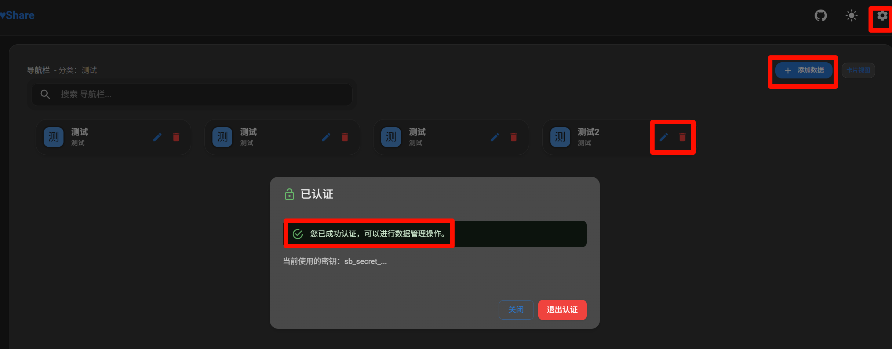

# LoveShare 导航

使用 React、TypeScript 和 Supabase 搭建的网站导航，适合整理个人收藏和团队常用网站。

- **访客**可按分类浏览，搜索网站名称、简介或网址，并切换管理员启用的卡片、列表和表格视图。
- **管理员**可在 `/admin` 管理网站、分类、置顶、排序和公开状态，自定义全站及各分类的默认视图。
- **部署**使用固定的 Supabase 表结构，只需配置项目 URL 和 Publishable Key。

## 快速开始

### 1. 初始化 Supabase

在 Supabase 项目的 **SQL Editor** 中执行 [`supabase/schema.sql`](supabase/schema.sql) 的全部内容。脚本会创建导航、分类、站点设置和管理员四张表，以及默认设置、索引和读写权限。执行后可在后台添加第一个网站。

### 2. 添加管理员

在 Supabase Dashboard 的 **Authentication → Users** 中创建邮箱及密码账号，并确认邮箱。将以下语句中的值替换为该账号的 **User UID**，然后在 SQL Editor 执行。

```sql
insert into public.navigation_admins (user_id)
values ('替换为管理员 User UID')
on conflict do nothing;
```

已公开的条目可供访客浏览。添加、编辑、删除和设置修改由 Supabase Auth 和行级安全策略（RLS）限制为管理员操作。

### 3. 配置并启动

将 [`.env.example`](.env.example) 复制为 `.env.local`。在 Supabase 项目的 **Connect** 中查找项目 URL 和 Publishable Key。旧项目可使用公开的 `anon` key。

```dotenv
VITE_SUPABASE_URL=https://your-project.supabase.co
VITE_SUPABASE_PUBLISHABLE_KEY=sb_publishable_your_key
```

使用 Node.js 22.12 或更高版本，也支持 Node.js 20.19 及以上的 20.x 版本。

```sh
pnpm install
pnpm dev
```

打开终端显示的地址，进入 `/admin` 登录。未配置 Supabase 时，首页会显示示例目录。

## 管理后台

| 页面 | 可用操作 |
| --- | --- |
| 链接管理 | 添加、编辑、删除、置顶、调整排序及控制公开状态。链接可直达网站，也可先打开站内说明。 |
| 分类管理 | 添加、改名、排序和设置分类默认视图。删除分类时，该分类下的链接会移到「未分类」。 |
| 呈现设置 | 修改站点名称、简介、默认主题、分类入口位置、每页数量、图标、域名和外链打开方式。可分别启用卡片、列表和表格，选择默认视图并预览。 |

访客主动切换的视图保存在自己的浏览器中。未公开的链接及其站内说明仅管理员可读取。

## 从旧版升级

1. 备份旧项目的 `public.navigation`，然后在同一个 Supabase 项目执行 [建表与迁移脚本](supabase/schema.sql)。
2. 按上文添加 Supabase Auth 管理员。脚本会应用新版导航权限，并收回旧 `navigation_obj` 分类视图的前端访问权限。
3. 部署新版后在后台调整站点名称、主题和视图。旧的 `VITE_SUPABASE_PUBLISHABLE_DEFAULT_KEY` 仍可用作公开密钥的兼容别名。

迁移可重复执行。现有链接、摘要、图标、站内说明、ID 和已有 slug 会保留。分类从原表的 `obj` 导入，空分类归入「未分类」。原有 `/article/<slug>` 和 `/article/<slug>.html` 地址仍可访问已公开的站内说明。旧库中手工录入的外链可以在后台审核、隐藏或删除。

## 数据表

| 表 | 用途 |
| --- | --- |
| `navigation` | 网站链接、站内说明、公开状态和排序 |
| `navigation_categories` | 分类、顺序和分类默认视图 |
| `navigation_settings` | 站点呈现设置 |
| `navigation_admins` | 管理员的 Supabase Auth 用户 ID |

## 部署

[](https://vercel.com/new/clone?repository-url=https%3A%2F%2Fgithub.com%2FGalokPeng%2FLoveShare&env=VITE_SUPABASE_URL,VITE_SUPABASE_PUBLISHABLE_KEY)

在 Vercel 导入仓库时选用 **Vite**，并填入前述两个环境变量。`vercel.json` 已配置后台和站内说明的直达路由。

使用其他静态托管服务时，运行 `pnpm build`，发布 `dist/`，并将 `/admin`、`/admin/*` 和 `/article/*` 回退到 `index.html`。可以用 `pnpm lint` 检查代码，使用 `pnpm preview` 本地预览构建结果。

## 旧版截图

<details>
<summary>查看旧版演示和管理截图</summary>




</details>

## 许可证

[MIT](LICENSE)
